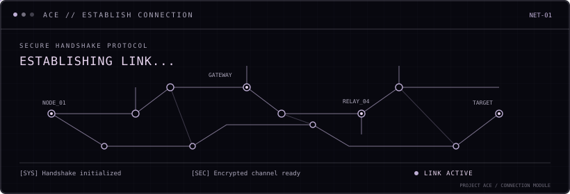
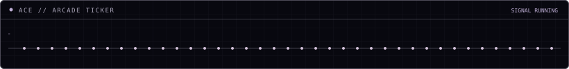

 

  

---

## ◈│ PROJECT ACE

**A window into our ever-changing world.**

Project ACE is a real-time global data terminal built to explore the events shaping our planet. It brings geographic data into an interactive 3D environment, turning raw signals into a visual experience that is easier to explore and understand.

<table>
  <tr>
    <td width="60%" valign="top">
      <h3>What is ACE?</h3>
      

        At its core, ACE combines data engineering, backend architecture,
        and interactive visualization. Its globe serves as a living
        canvas for global events — connecting incoming information
        with the places where it happens.
      

      <h3>Made to explore</h3>
      

        ◇ <strong>Global activity</strong> 
        Explore earthquake and volcanic activity through external data sources.
      

      

        ◇ <strong>A world in 3D</strong> 
        Discover geographic events through an interactive globe and spatial visualization.
      

      

        ◇ <strong>Built to grow</strong> 
        A modular architecture designed to make new data domains easier to integrate.
      

      <h3>Under the surface</h3>
      

        <strong>Backend</strong> · Python, FastAPI, Pydantic 
        <strong>Frontend</strong> · React, Three.js, D3 Geo 
        <strong>Communication</strong> · JSON HTTP API
      

      <h3>Where it stands</h3>
      

        <strong>OMORI</strong> is the current focus, centered on seismic
        and volcanic activity. Other domains remain part of ACE's
        longer-term vision.
      

      

        <a href="https://github.com/otp-katana/PROJECT-ACE---All-Covering-Eye-Real-Time-Global-Data-Terminal">
          Explore the project ↗
        </a>
      

<td width="40%" valign="top" align="center">
  
    
  
    
  
</td>

  </tr>
</table>

---

## 〒│ TECHNICAL ARSENAL

  

---

## ✈│ ACTIVITY ARCADE

  

  

---

## ▱│ GITHUB SIGNAL

  <table>
    <tr>
      <td align="center" width="50%">
        
      </td>
      <td align="center" width="50%">
        
      </td>
    </tr>
  </table>

---

## ⍚│ ESTABLISH CONNECTION

  

  

