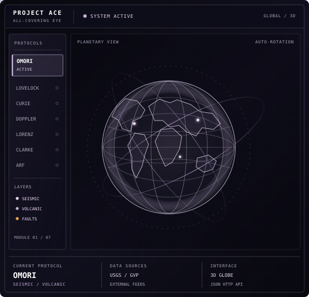

 

  

---

## `01` / FEATURED PROJECT

<!-- PROJECT ACE -->
<h2>◈ PROJECT ACE — All-Covering Eye</h2>

<table>
  <tr>
    <td width="60%" valign="top">

      <h3>A Real-Time Global Data Terminal</h3>

      

        <em>
          Turning scattered signals into a living picture of our planet.
        </em>
      

      

        Project ACE is an ongoing data engineering and visualization
        project that brings global events into a unified, interactive
        3D environment. Its central interface is a cyber-globe designed
        to connect incoming data streams with spatial visualization
        and modular monitoring systems.
      

      <h4>CORE CAPABILITIES</h4>

      <ul>
        <li>
          <strong>Global Event Monitoring</strong> — visualizing
          earthquake and volcanic activity through external data sources.
        </li>
        <li>
          <strong>Interactive 3D Globe</strong> — exploring geographic
          events through a spatial interface.
        </li>
        <li>
          <strong>Modular Architecture</strong> — organizing data
          providers, backend protocols, and visualization layers
          for future expansion.
        </li>
        <li>
          <strong>Data-Driven Design</strong> — connecting structured
          data with a clear, interactive visual experience.
        </li>
      </ul>

      <h4>ENGINEERING STACK</h4>

      

        <strong>Backend:</strong>
        Python · FastAPI · Pydantic
         
        <strong>Frontend:</strong>
        React · Three.js · D3 Geo
         
        <strong>Communication:</strong>
        JSON HTTP API
      

      <h4>MODULE STATUS</h4>

      

        <strong>OMORI</strong> — current focus: seismic and volcanic
        activity monitoring.
      

      

        Additional modules are part of the project's longer-term
        expansion roadmap.
      

      

        <a href="https://github.com/otp-katana/PROJECT-ACE---All-Covering-Eye-Real-Time-Global-Data-Terminal">
          <strong>↗ EXPLORE PROJECT ACE</strong>
        </a>
      

    </td>

    <td width="40%" valign="middle" align="center">

      

    </td>
  </tr>
</table>

---

## `02` / TECHNICAL ARSENAL

**LANGUAGES**

**BACKEND & DATA**

**TOOLS & ENVIRONMENT**

---

## `03` / ACTIVITY ARCADE

  

---

## `04` / GITHUB SIGNAL

---

## `05` / ESTABLISH CONNECTION

  

Building quietly. Thinking systemically. Shipping deliberately.

